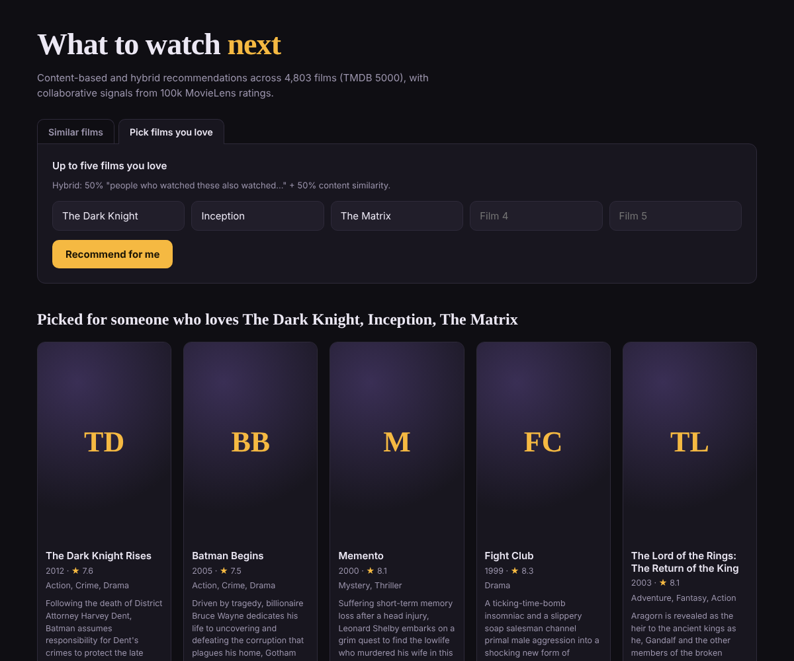

# 🎬 Movie Recommender: Content-Based, Collaborative and Hybrid

A Flask web app that recommends films in two ways:

- **Similar films (content-based).** Pick one film and get the films closest to it in plot, genres, keywords, lead cast and director.
- **Pick films you love (hybrid).** Pick up to five films. The app blends *"people who watched these also watched…"* (item-based collaborative filtering on MovieLens ratings) with content similarity.

Built for the IntElligence Data Science Training & Internship *End-to-End Project: Movie Recommender App*.



## Results at a glance

**Rating prediction** (MovieLens, random 80/20 split, RMSE in stars, lower is better):

| Model | RMSE |
|---|---|
| Global mean | 1.049 |
| User mean | 0.950 |
| surprise KNNBasic (user-based, cosine) | 0.980 |
| surprise KNNWithMeans (user-based, Pearson) | 0.904 |
| **User-based CF written from scratch** (k=30, mean-centred / Pearson) | 0.884 |
| Baseline (user + film biases) | 0.882 |
| **surprise SVD** (50 factors) | **0.869** |

**Top-10 recommendation quality.** Each user's ratings are split by time: the first 80% is history and the last 20% is the future. We count how many of the 10 recommended films the user went on to rate 4★ or higher. 583 users.

| Recommender | Precision@10 | Hit-rate@10 |
|---|---|---|
| Random | 0.002 | 0.02 |
| Content-based (TF-IDF, weighted fields) | 0.017 | 0.13 |
| Popularity (most-rated) | 0.058 | 0.32 |
| Collaborative (item-based CF) | 0.079 | 0.43 |
| **Hybrid, w = 0.5** (used in the app) | **0.083** | **0.46** |

Content-based alone finds *similar* films, but not the ones people actually go on to watch. Popularity is a strong baseline. Item-based CF beats popularity, and the 50/50 hybrid scores best overall. It also keeps a content route for films with few ratings (the cold-start problem). The full reasoning is in [`analysis.ipynb`](analysis.ipynb).

## Project structure

```
movie-recommender/
├── analysis.ipynb          # data cleaning, EDA, content-based, collaborative, hybrid, evaluation
├── recommender.py          # shared feature engineering + scoring (used by notebook AND app)
├── app.py                  # Flask app: / , /recommend , /hybrid , /api/recommend , /health
├── templates/index.html    # UI
├── model.pkl               # movie table (title, year, genres, cast, director, ratings…)
├── similarity.pkl          # top-50 content-based neighbours per film
├── hybrid.pkl              # TF-IDF matrix + item-item CF matrix + tuned blend weight
├── requirements.txt        # app/runtime dependencies
├── requirements-notebook.txt
├── Dockerfile
└── data/
    ├── tmdb_5000_movies.csv
    ├── tmdb_5000_credits.csv
    └── movielens/          # ml-latest-small: ratings.csv, links.csv, movies.csv, README.txt
```

## Run it

### Locally

```bash
python -m venv .venv && source .venv/bin/activate      # Windows: .venv\Scripts\activate
pip install -r requirements.txt
python app.py
```

Open <http://localhost:5000>.

### With Docker

```bash
docker build -t movie-recommender .
docker run -p 5000:5000 movie-recommender
```

### Optional: movie posters

Get a free API key from [themoviedb.org](https://www.themoviedb.org/settings/api) and pass it in as an environment variable. Without a key the app still works and shows title cards instead of posters.

```bash
TMDB_API_KEY=your_key python app.py
# or
docker run -p 5000:5000 -e TMDB_API_KEY=your_key movie-recommender
```

### Re-run the analysis

```bash
pip install -r requirements-notebook.txt
jupyter notebook analysis.ipynb
```

The notebook regenerates `model.pkl`, `similarity.pkl` and `hybrid.pkl`. It runs in under a minute.

## How it works

1. **Data.** TMDB movies and credits are merged on `id`. Merging on title, as the starter code did, creates fake rows, because *Batman*, *The Host* and *Out of the Blue* each exist twice. The JSON-in-text columns are parsed into lists.
2. **Content features.** Each film gets a `tags` string built from overview, genres, keywords, top-3 cast and director. Names are collapsed (`Sam Worthington → samworthington`) and words are Porter-stemmed. Fields are weighted: genres, keywords and cast ×2, director ×3. This beat equal weights in the offline evaluation.
3. **Content-based model.** TF-IDF (5,000 terms) plus cosine similarity. TF-IDF beat CountVectorizer. Only the top 50 neighbours per film are stored: the full 4,803 × 4,803 matrix is about 185 MB, which is over GitHub's 100 MB file limit, and gives the same recommendations.
4. **Collaborative filtering.** MovieLens latest-small (100,836 ratings, 610 users). Its `links.csv` maps every film to its TMDB id. User-based CF is written from scratch with mean-centred cosine similarity (equivalent to Pearson) and compared with surprise's KNN models and SVD.
5. **Hybrid.** `score = w × item-based CF + (1 − w) × content`, both min-max scaled. The weight `w` was tuned on the time-based evaluation above.

## Fixes to the starter code

- The supplied `tmdb_5000_credits.csv` was truncated: only 1,492 of 4,803 films had cast and crew, and the rest were blank rows. It has been replaced with the complete original Kaggle file.
- The starter notebook parsed genres but left them out of the tags. They are now included.
- The starter `similarity.pkl` would have been about 185 MB, too big for GitHub. It is now stored as top-k neighbours.
- The TMDB API key was hard-coded in `app.py`. It is now read from an environment variable, poster requests run in parallel with a timeout and a cache, and a failed request no longer breaks the page.
- The template showed the "Recommended Movies" heading even when there were no results.

## Data and credits

- **TMDB 5000 Movie Dataset** ([Kaggle](https://www.kaggle.com/datasets/tmdb/tmdb-movie-metadata)). This product uses the TMDB API but is not endorsed or certified by TMDB.
- **MovieLens latest-small:** F. Maxwell Harper and Joseph A. Konstan. 2015. *The MovieLens Datasets: History and Context.* ACM TiiS 5(4). Redistributed under the GroupLens usage licence. See `data/movielens/README.txt`.

## Future improvements

- A logged-in mode that uses each user's own SVD vector.
- Diversity and novelty re-ranking, so that 7 Batman films don't fill the list.
- Sentence-embedding models for plot text.
- Cloud deployment (Render, Fly.io or AWS).
